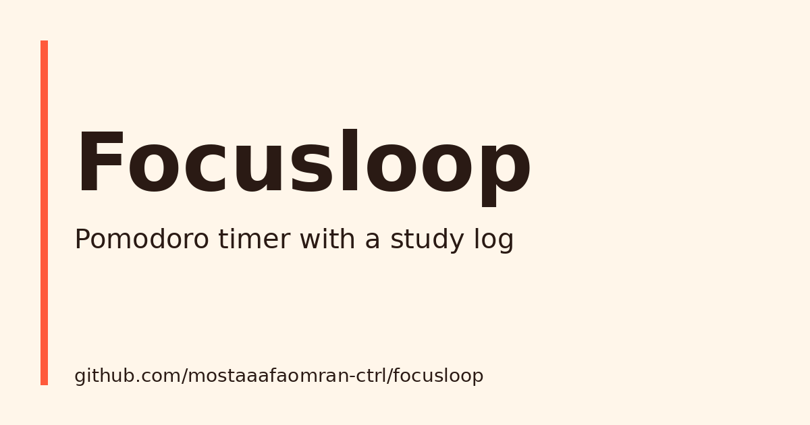

# Focusloop

Pomodoro timer with a study log.

 

**Live demo:** https://mostaaafaomran-ctrl.github.io/focusloop/ (add `?demo=1` to see it filled with sample data)

Pomodoro timer that logs what you studied, with today total, streak and a 7-day chart. Offline.

## Features

- Focus, short break and long break with your own minutes
- Logs subject and minutes for every finished session
- Today total, daily streak and a 7-day bar chart
- Sound at the end and the countdown in the tab title
- Saved on your device only

## Run it locally

It is one `index.html` file. Open it in a browser. No build step, no dependencies, no server.

## Privacy

Everything runs in your browser. Nothing is uploaded. Data you enter is kept in your browser's local storage on your device only.

## بالعربي

تايمر بومودورو بيسجل بتذاكر إيه، ويعرضلك وقت النهاردة والستريك ورسم لآخر 7 أيام.

افتح الملف `index.html` في المتصفح وهيشتغل على طول، من غير تسجيل ومن غير سيرفر.

## License

MIT
